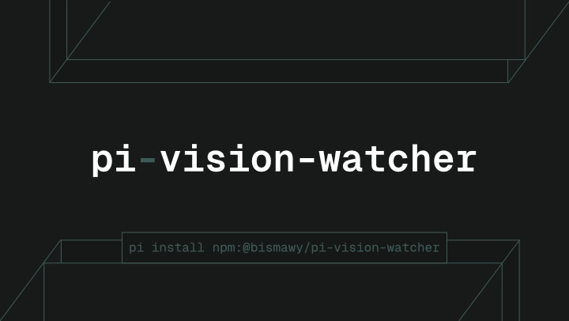

# Vision Watcher

Intelligent vision watcher. Connected models. Zero workflow interruption.

[](https://pi.dev/packages/@bismawy/pi-vision-watcher)
[](https://www.npmjs.com/package/@bismawy/pi-vision-watcher)
[](https://github.com/bismawy/pi-vision-watcher)



## Overview

pi-vision-watcher gives text-only pi models vision — images are described in the background by a vision model you pick, watching over text-only coding models without interrupting your workflow.

- Connected-only Picker: `/vision-watcher` filters models to connected providers with valid credentials.
- Batching & Cache: Parallel tool calls batch images into one request; SHA-256 cache prevents redundant descriptions.
- False-Vision Healing: Proactively detects text-only models falsely advertised as multimodal and auto-heals `models.json` on HTTP 400.
- Thinking Controls: Configurable reasoning effort (`off` – `max`) for reasoning-capable vision models.
- Failover Chains: Ordered fallbacks to backup vision models on timeouts, rate limits, or auth errors.

## Install

```bash
pi install npm:@bismawy/pi-vision-watcher
```

Run `/vision-watcher` to pick a vision model (or `/vision-watcher model <provider/id>`). Handoff is enabled by default.

To test locally without installing:
```bash
pi --extension ./vision-watcher.ts
```

## Shortcuts

| Key | Action |
| --- | --- |
| `↑` · `↓` | Move the highlight up/down the list |
| `space` | Toggle highlighted model as primary describer |
| `tab` | Toggle highlighted model in/out of failover chain (max 3) |
| `r` | Reset failover chain (`ctrl+shift+r` also works) |
| `alt+↑` · `alt+↓` | Reorder the highlighted model (the chain follows list order) |
| `shift+tab` | Walk thinking ladder (`off` → `minimal` → `low` → `medium` → `high` → `xhigh` → `max`) |
| `/` | Open the filter; `enter` or `esc` closes it and keeps the query |
| `a` | Toggle async paste handoff (`alt+a`, or `ctrl+alt+a` on Linux) |
| `enter` · `ctrl+s` | Save configuration (primary describer and chain) |
| `esc` | Cancel and exit picker |

> **Notes:**
> - Letters are commands, not filter text: only `/` hands the keyboard to the filter. While it is open, `space` is a space character, so queries like `gemini 3.8` stay typeable; `enter` closes the filter and keeps the query, and a second `enter` saves.
> - The header names the whole configuration in model names (`Primary`, `Fallback` chain, `Thinking` level), so the picked models stay visible even when they sit outside the visible rows. Each row hugs its ref with a role marker: `✓ primary` in accent, `✓ fallback 1` in the primary tone, then the fact in parentheses (`(thinking off)`, `(no thinking)`). There is no per-row checkbox: the picker chooses one primary, so the role marker carries that and the primary row keeps the accent colour.
> - Letters are commands, so `a` and `r` are free: only `/` hands the keyboard to the filter. `tab` works on Windows Terminal/conhost, X11, macOS, tmux and SSH. `ctrl+s` is avoided because POSIX tty flow control (IXON) eats it on some terminals; `enter` does the same job.

## Commands

| Command | Action |
| --- | --- |
| `/vision-watcher` | Interactive picker for connected vision models |
| `/vision-watcher model <provider/id>` | Set primary vision describer directly |
| `/vision-watcher status` | View active configuration and failover chain |
| `/vision-watcher auto <on\|off>` | Toggle automatic handoff (default: `on`) |
| `/vision-watcher add \| remove <provider/id>` | Force or unforce handoff on specific models |
| `/vision-watcher thinking <level>` | Configure reasoning effort (`off` – `max`) |
| `/vision-watcher timeout <ms>` | Set per-image description timeout in ms (default: `45000`) |
| `/vision-watcher prewarm \| async <on\|off>` | Toggle paste-time prewarming or async clipboard fallback |
| `/vision-watcher clear` | Clear configured vision model |
| `/vision-watcher enable \| disable` | Toggle extension active state |
| `/vision-watcher help` | List all subcommands |

## Architecture

<details>
<summary><b>Configuration</b> (<code>~/.pi/agent/extensions/pi-vision-watcher.json</code>)</summary>

```json
{
  "enabled": true,
  "visionModel": "openai/gpt-4o",
  "fallbackModels": [],
  "autoHandoff": true,
  "handoffModels": [],
  "thinking": false,
  "thinkingLevel": "medium",
  "describeTimeoutMs": 45000,
  "prewarmPastedImages": false,
  "asyncClipboardHandoff": false,
  "maxTokens": null,
  "maxRequestBytes": 700000,
  "cacheMax": 50,
  "maxDescriptionLines": 0
}
```

Most fields have sane defaults — `visionModel` is the only one you normally set.

`fallbackModels` is the failover chain: when the primary describer fails (timeout, rate limit, auth), each entry is tried **in order** until one returns a description. The picker caps the chain at 3 entries (`tab`). Set it from the picker instead of hand-editing the file.

`maxRequestBytes` (default `700000`) is the byte budget for one describer request body, prompt text and base64 images together. Aggregator proxies such as Remote Magpie reject a body near 1 MB with HTTP 413 no matter how large the model context is, so an image above the budget is re-encoded down and the batch is split into sequential calls that each fit. Set it to your provider's limit; `0` disables the budget.

</details>

<details>
<summary><b>Diagnostics & Recovery</b></summary>

- Failed vision calls log with stack traces to `~/.pi/agent/logs/pi-vision-watcher/errors.log` and degrade gracefully to `[Image: description unavailable]`.
- When a model falsely advertises image capability and 400s, the error is captured on `message_end`, `modelOverrides.<model>.input = ["text"]` is written to `models.json`, and the registry refreshes in-process.

</details>

<details>
<summary><b>Components</b></summary>

| File | Role |
| --- | --- |
| `vision-watcher.ts` | Extension entry point, lifecycle hooks, and CLI command handlers |
| `src/vision-model-selector.ts` | Interactive TUI model picker with connected-only filtering |
| `src/describer.ts` | Vision API request orchestration, multi-image batching, and failover chains |
| `src/dataloader.ts` | Batched image loader to prevent redundant parallel requests |
| `src/image.ts` | Image hashing (SHA-256), memory caching, and MIME detection |
| `src/prewarm-editor.ts` | Paste-time image prewarming and async clipboard injection |
| `src/error-log.ts` | Structured logging and error capture |

</details>

<details>
<summary><b>Development</b></summary>

```bash
npm test          # Vitest suite (250+ unit tests)
npm run typecheck # TypeScript checks
npm run lint:dead # Knip dead code analysis
```

</details>

## License

Distributed under the **MIT** license.

## Author

[Bisma](https://github.com/bismawy)
